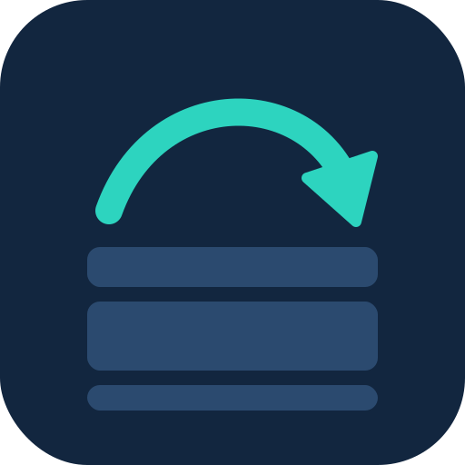

<p align="center"></p>

# leap_sliver_list

SliverList and ListView - supercharged. A maintained fork of [`super_sliver_list`](https://github.com/superlistapp/super_sliver_list).

> **Migrating from `super_sliver_list`?** Replace the dependency with `leap_sliver_list` and change the import to `package:leap_sliver_list/leap_sliver_list.dart`. The public API (`SuperSliverList`, `SuperListView`, `ListController`, ...) is unchanged.

`SuperSliverList` and `SuperListView` are drop in replacement widgets for `SliverList` and `ListView` with greatly improved performance and additional features:

#### Fast scrolling with large amount of items with variable extents

`SliverList` performance degrades heavily when quickly scrolling through a large amount of items with different extents, requiring workarounds such as using `FixedExtentSliverList` or prototype items. `SuperSliverList` uses different layout algorithm and can handle virtually unlimited number of items with variable extents without any slow-downs.

#### Ability to jump or animate to specific item

`SliverList` does not provide any way to jump or animate a particular index. There is a [scrollable_positioned_list](https://pub.dev/packages/scrollable_positioned_list) package that provides this functionality, but it comes at a cost, as it requires custom scroll view, does not seem to work properly with Scrollbars, can't be used with with other slivers (such as sticky headers) and ultimately is backed by a `SliverList` so it has the same performance issues as mentioned above.

`SuperSliverList` provides a way to reliably jump and animate to a specific item, even if the item is outside of the viewport and has not been built or laid out yet.

#### Smooth and predictable scrollbar behavior

`SliverList` is quite prone to scrollbar erraticaly jumping around when scrolling through a list of items with different extents. With `SuperSliverList` the scrollbar should behave more predictably. See the [Advanced](#advanced) section for more details.

## Basic Usage

`SuperListView` is a drop-in replacement for `ListView`, and as such you can use it same way you'd use `ListView`:

```dart
SuperListView.builder(
  itemCount: 1000,
  itemBuilder: (context, index) {
    return ListTile(title: Text('Item $index'));
  },
)
```

`SuperSliverList` is a drop-in replacement for `SliverList` and should work with any `CustomScrollView` configuration:
 ```dart
 CustomScrollView(
   slivers: <Widget>[
     SliverPadding(
       padding: const EdgeInsets.all(20.0),
       sliver: SuperSliverList(
         delegate: SliverChildListDelegate(
           <Widget>[
             const Text("I'm dedicating every day to you"),
             const Text('Domestic life was never quite my style'),
             const Text('When you smile, you knock me out, I fall apart'),
             const Text('And I thought I was so smart'),
           ],
         ),
       ),
     ),
   ],
 )
 ```

## Jumping and animating to specific item

`ListController` can be provided to `SuperSliverList`/`SuperListView` and used to jump or animate to specific item:

```dart
class _MyState extends State<MyWidget> {
  final _listController = ListController();
  final _scrollController = ScrollController();

  @override
  Widget build(BuildContext context) {
    return SuperListView.builder(
      listController: _listController,
      controller: _scrollController,
      itemCount: 1000,
      itemBuilder: (context, index) {
        return ListTile(title: Text('Item $index'));
      },
    );
  }

  void jumpToItem(int index) {
    _listController.jumpToItem(
      index: index,
      scrollController: _scrollController,
      alignment: 0.5,
    );
  }

  void animateToItem(int index) {
    _listController.animateToItem(
      index: () => index,
      scrollController: _scrollController,
      alignment: 0.5,
      // You can provide duration and curve depending on the estimated
      // distance between currentPosition and the target item position.
      duration: (estimatedDistance) => Duration(milliseconds: 250),
      curve: (estimatedDistance) => Curves.easeInOut,
    );
  }
}
```

### Awaiting and canceling animations

`animateToItem` returns an `ItemAnimation`, a `Future<void>` that completes when the animation is over. It never completes with an error: check `isCanceled` to know whether the item was reached.

```dart
final animation = _listController.animateToItem(
  index: () => 500,
  scrollController: _scrollController,
  alignment: 0.5,
  duration: (_) => const Duration(milliseconds: 400),
  curve: (_) => Curves.easeInOut,
);
await animation;
if (animation.isCanceled) {
  // The user scrolled, another animation started, ...
}
animation.cancel(); // stops at the current position
```

### Separated lists

With `SuperSliverList.separated` / `SuperListView.separated`, `ListController` indexes your items, not the separators, so `jumpToItem(index: 10, ...)` shows item 10. Pass `listControllerIndexesItems: false` to get the raw child indexes instead.

### Offsets, visible items and `center`/`anchor`

```dart
_listController.offsetForIndex(42);                 // scroll offset of item 42
_listController.getOffsetToReveal(42, 0.5);         // offset that aligns it to the middle
_listController.firstVisibleIndex;                  // int?
_listController.lastVisibleIndex;                   // int?
```

`jumpToItem`, `animateToItem` and `getOffsetToReveal` honor a custom `center` and `anchor` of the viewport and accept an `obstruction` (`ChildObstructionExtent`) for space covered by something the list does not know about, such as a `SliverStickyHeader` (from `flutter_sticky_header`) wrapping the list:

```dart
_listController.jumpToItem(
  index: 10,
  scrollController: _scrollController,
  alignment: 0.0,
  obstruction: const ChildObstructionExtent(leading: 56, trailing: 0),
);
```

### Inserting items above the viewport

Tell the controller about the insertion and the visible content stays where it is (useful for chats and feeds that prepend older messages):

```dart
setState(() => messages.insertAll(0, olderMessages));
_listController.addItem(0, count: olderMessages.length, preserveScrollPosition: true);
```

The scroll position is compensated exactly for up to 256 inserted items that are not built yet; for larger insertions the estimated extents are used.

## Advanced

Very roughtly speaking `SuperSliverList` works by estimating the extent of items that are outside of viewport and when these items are scrolled into the viewport cache area the scroll position is transparently adjusted to account of the difference between estimated and actual extents. On small lists this difference may result in scrollbar movement not being perfectly aligned with list movement. `SuperSliverList` provides two ways to rectify this:

### Improve extent estimation

You can register custom callback that will be used to estimate extent of estimated items. This can be useful if you have an idea, atleast approximately, how large the extent of each item is.

```dart
SuperSliverList(
    delegate: /*...*/,
    estimateExtent: (index) => 100.0, // Provide your own extent estimation
)
```

### Precalculate extents for items

`SuperSliverList` can, if needed, asynchronously precalculate extents for items. To enfore this, subclass `ExtentPrecalculationPolicy` and provide it to `SuperSliverList`:

In this example the extents are eagerly precalculated for lists with less than 100 items:

```dart
class MyPrecalculationPolicy extends ExtentPrecalculationPolicy {
  @override
  bool shouldPrecaculateExtents(ExtentPrecalculationContext context)  {
    return context.numberOfItems < 100;
  }
}

return SuperSliverList(
    delegate: /*...*/,
    extentPrecalculationPolicy: myPolicy,
)
```

The threshold is arbitrary, but in general there are diminishing returns for precalculating extents for large lists, as the extent estimation error for each item has much smaller impact on the scrollbar position if there are many items.

## Example

See the [example](example) folder for a complete sample app using `SuperSliverList`.

## Benchmark

`benchmark/layout_benchmark.dart` compares `SliverList` and `SuperSliverList` (10,000 items with variable heights) and times `jumpToItem`:

```
flutter test benchmark/layout_benchmark.dart
```

It runs in the headless `flutter_tester` (debug/JIT, CPU only), so use it to compare implementations and versions on the same machine, not as device numbers. Tune it with `--dart-define=ITEMS=100000`, `FRAMES` and `RUNS`.

Reference run (Linux, 8 cores, Flutter 3.47.8, per-frame time of `pump`):

| Scenario | SliverList | SuperSliverList |
|----------|-----------|-----------------|
| scroll 120 px/frame, mean / p95 | 1.78 / 3.43 ms | 1.28 / 1.83 ms |
| scroll 5000 px/frame, mean / p95 | 4.24 / 9.23 ms | 1.19 / 2.35 ms |
| `jumpToItem` to a random item and settle, mean | not available | 4.92 ms |

## Roadmap

Ideas that are not done yet:

* Initial scroll position without a post-frame jump (upstream #58, #69).
* Scroll anchoring when the height of an item above the viewport changes.
* Native sticky headers and a multi-column variant.
* Integration tests on devices, and benchmarks on web/wasm. Only the Dart VM test runner and the web build are verified today; iOS and Android are not.

## Attribution

`leap_sliver_list` is a fork of [`super_sliver_list`](https://github.com/superlistapp/super_sliver_list) v0.4.1 by Matej Knopp, Superlist and the contributors, released under the MIT license. The original code is imported at upstream commit `bfa3d5d` (without its git history) and is maintained here. This project is not affiliated with or endorsed by Superlist. See [NOTICE](NOTICE) and [LICENSE](LICENSE).
